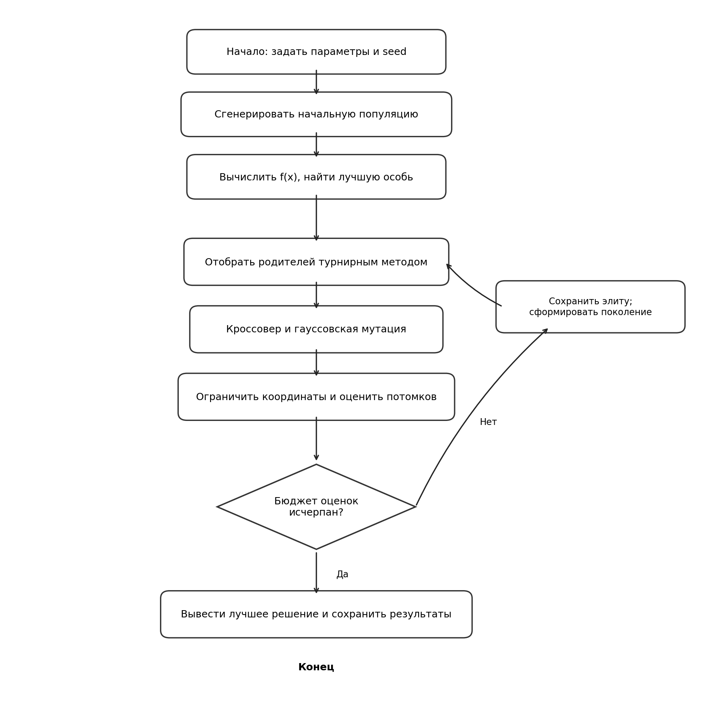
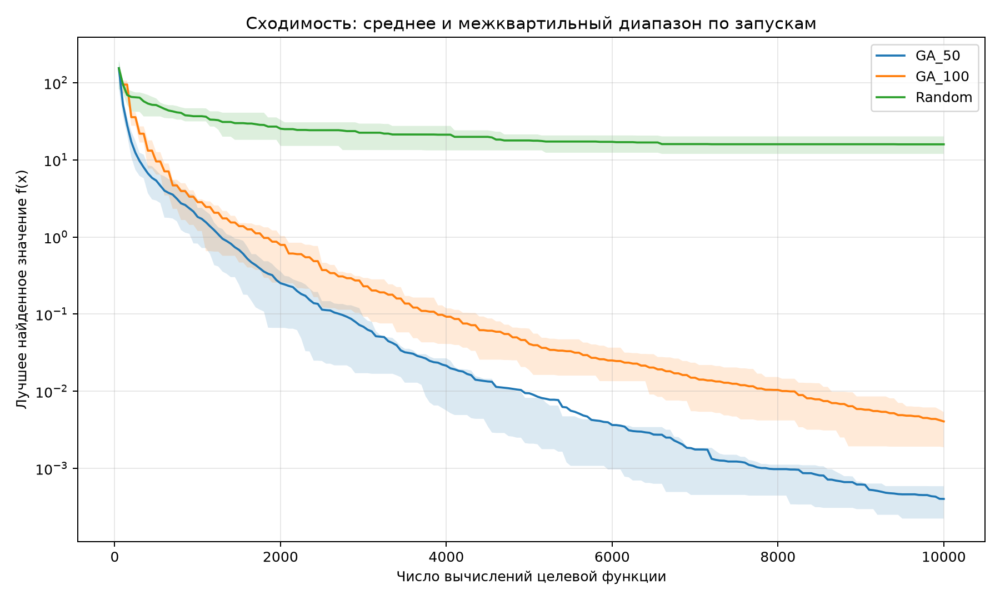

# Лабораторная работа № 1
## Многомерная оптимизация сложной функции генетическим алгоритмом

**Дисциплина:** «Эволюционное программирование и генетические алгоритмы»  
**Индивидуальный вариант:** 8  
**Язык:** Python 3

## 1. Цель работы
Реализовать генетический алгоритм непрерывной оптимизации и исследовать влияние размера популяции. Сравнить алгоритм со случайным поиском при одинаковом бюджете вычислений целевой функции.

## 2. Постановка задачи
Для варианта 8 используется функция Захарова:

\[
f(x)=\sum_{i=1}^d x_i^2+
\left(\sum_{i=1}^d 0.5 i x_i\right)^2+
\left(\sum_{i=1}^d 0.5 i x_i\right)^4.
\]

Размерность задаётся формулой методички: \(d=5+(V\bmod 6)=7\). В реализации используется область \(x_i\in[-5,10]\). Теоретический глобальный минимум равен нулю и достигается при \(x=(0,\ldots,0)\).

## 3. Представление и операторы
Особь — вектор из семи вещественных координат. Значение функции служит целевой оценкой: чем оно меньше, тем лучше решение.

- **Инициализация:** равномерная генерация координат в заданных границах.
- **Селекция:** турнир из трёх случайных особей; выбирается особь с минимальным значением функции.
- **Кроссовер:** арифметический, с вероятностью 0.9; координаты потомка — выпуклая комбинация координат родителей.
- **Мутация:** каждая координата мутирует с вероятностью \(1/d\); добавляется нормальный шум со стандартным отклонением 0.5.
- **Обработка ограничений:** координаты обрезаются до отрезка \([-5,10]\).
- **Элитизм:** лучшая особь переносится в следующее поколение вместе с уже вычисленным значением целевой функции.
- **Остановка:** ровно 10 000 фактических вычислений целевой функции на запуск.

## 4. Схема алгоритма


## 5. Эксперимент
Выполнено по 20 запусков для каждой конфигурации, seed от 42 до 61. Сравнивались:
1. `GA_50` — генетический алгоритм с популяцией 50;
2. `GA_100` — генетический алгоритм с популяцией 100;
3. `Random` — равномерный случайный поиск.

Для каждого запуска использован бюджет 10 000 оценок целевой функции. Менялся только размер популяции между двумя конфигурациями генетического алгоритма. Результаты всех запусков сохранены в `results.csv`.

## 6. Результаты

| Алгоритм | Минимум | Среднее | Медиана | Ст. отклонение | Максимум |
|---|---:|---:|---:|---:|---:|
| GA_50 | 6.2187e-05 | 0.00040187 | 0.000347122 | 0.000236636 | 0.000819436 |
| GA_100 | 0.000630247 | 0.00406606 | 0.00287214 | 0.00307816 | 0.0117266 |
| Random | 4.82592 | 15.922 | 15.6953 | 5.77183 | 25.2538 |

Лучший результат серии получен `GA_50`, запуск № 19: \(f(x)=6.2187e-05\). Найденный вектор:

`[0.005421209618423855, 0.0012656817573877075, 0.002544289345283086, 0.0036884813551150775, 0.00018113029785358863, -0.0021652465811184277, -0.002319958827306493]`

## 7. График сходимости


График показывает среднее лучшее значение по запускам и межквартильный диапазон. По оси X отложено число фактических вычислений целевой функции, поэтому сравнение выполнено при общей вычислительной шкале.

## 8. Обсуждение
Среднее значение для `GA_50` равно 0.00040187, для `GA_100` — 0.00406606, для случайного поиска — 15.922. В данной серии популяция 50 особей дала более низкие итоговые значения, чем популяция 100. Это наблюдение относится к выбранным параметрам и бюджету, а не является универсальным утверждением о превосходстве меньшей популяции.

Случайный поиск не использует качество предыдущих точек для построения новых кандидатов. В семимерной области вероятность случайно попасть в очень малую окрестность нуля невелика. Генетический алгоритм использует селекцию и рекомбинацию, чтобы чаще исследовать области, содержащие относительно хорошие решения. Мутация сохраняет возможность исследовать новые точки.

## 9. Вывод
Реализован генетический алгоритм с вещественным кодированием, турнирным отбором, арифметическим кроссовером, гауссовской мутацией, ограничением координат и элитизмом. Проведено сравнение двух размеров популяции со случайным поиском на серии из 20 запусков при бюджете 10 000 вычислений целевой функции на запуск. В проведённом эксперименте генетические алгоритмы существенно приблизились к теоретическому минимуму функции Захарова и превзошли случайный поиск. Для окончательного вывода о настройках необходимы дополнительные эксперименты с параметрами мутации и отбора.

## 10. Воспроизводимость
Установить зависимости:

```bash
python -m pip install numpy pandas matplotlib
```

Запуск:

```bash
python main.py --runs 20 --budget 10000 --seed 42
```

Файлы `results.csv`, `summary.csv` и `convergence.png` создаются автоматически.
